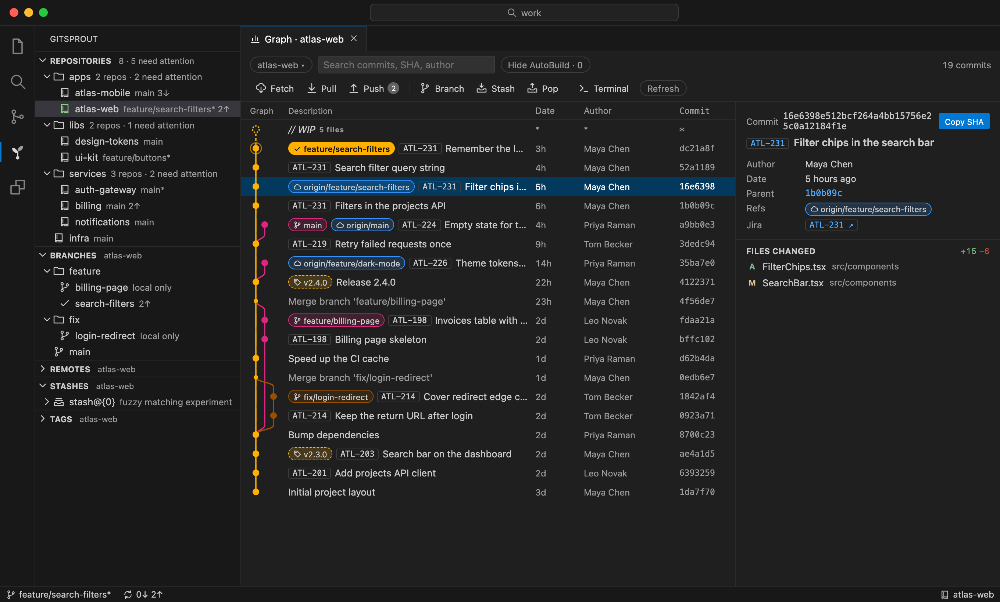
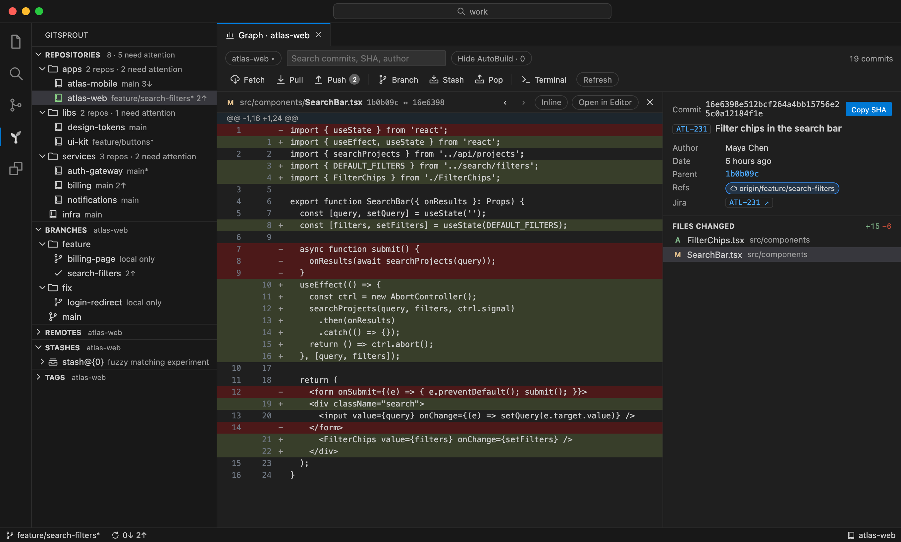
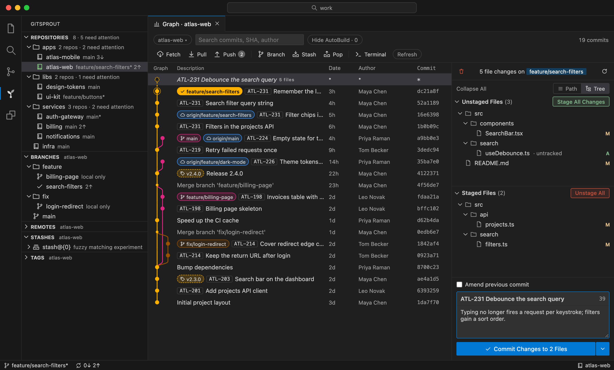
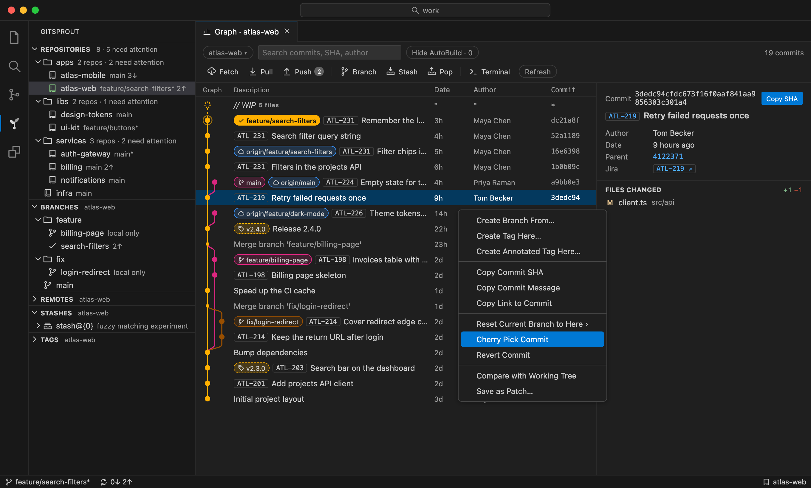

# Gitsprout 🌱

A VS Code (and Cursor) extension for the everyday 90% of Git work across one or many repositories: switch branches, see what changed, browse the commit graph, fetch/pull/push, stash. No subscription, no accounts, no cloud. Every action runs your own `git`, so your config, hooks and SSH keys just work.

Gitsprout adds what the built-in Source Control lacks: a commit graph with a GitKraken-style staging and commit panel, a branch/remote/stash/tag tree, and an overview of every repository in a big workspace folder.



## Features

**Many repositories, one sidebar.** Open a folder like `~/work` with dozens of repos in nested folders: Gitsprout finds them, groups them by folder and marks the ones that need attention (uncommitted changes, ahead, behind). Fetch All, quick repo switching, and the active repo follows the editor you are in.

**Commit graph.** One tab per repository: lanes, branch and tag pills, search by message, SHA or author, hide CI commits, commit details, Jira keys (`PROJ-123`) as links. A toolbar for Fetch, Pull, Push (with ahead/behind counts), Create Branch, Stash, Pop and a terminal in the repo.

**Inline diffs.** Click a file of a commit or of your working tree and its diff replaces the graph: inline or split, `j`/`k` to the next file, "Open in Editor" for VS Code's native diff editor.



**Stage and commit from the graph.** Select the Uncommitted Changes row: Unstaged and Staged lists (path or tree), stage, unstage and discard files, folders or everything, a commit summary with a 72-character counter, a description, amend, commit, or commit and push.



**Graph actions.** Right-click a commit: create a branch or tag, copy SHA, message or link, reset the current branch to it, cherry-pick, revert, compare with the working tree, save as a patch.



**Branches, remotes, stashes, tags.** Tree views for the active repo: checkout (a remote checkout creates a tracking branch), create, rename, delete, set upstream, stash push/apply/pop/drop, push and delete tags.

**Worktrees.** A Worktrees view lists every `git worktree` of the active repo with its branch, changes and ahead/behind, and creates one from a branch, a remote branch, a new branch or a commit. Open one as a graph tab, in a new or this window, as a workspace folder or in a terminal; remove and prune them. Linked worktrees nest under their repo in Repositories, branches checked out in another worktree are marked and guarded against checkout, and the graph shows other worktrees' checked-out branches and their uncommitted changes as dashed rows on top of their HEAD commits.

**Fetch, pull, push with clear errors.** Pull fast-forwards or merges, a rejected push offers Pull, a branch without upstream offers Publish, an authentication failure offers the same command in a terminal.

Not planned: hunk/line staging, interactive rebase, conflict editor, PR/issue integrations, AI features.

## Install

- VS Code: Extensions view → search "Gitsprout", or `code --install-extension fosteev.gitsprout`
- Cursor, VSCodium and other editors on Open VSX: Extensions view → search "Gitsprout"
- From a `.vsix`: Extensions view → `…` → Install from VSIX…

Requires VS Code 1.90+ (or an editor on a matching VS Code base) and git 2.24+ on the PATH (or `git.path` set).

## Usage

- Gitsprout view in the activity bar: Repositories (multi-repo workspaces only), Branches, Remotes, Stashes, Tags. The status bar item shows the active repository and branch; the active repo follows the active editor.
- Graph tab: `Gitsprout: Show Graph` (`⌥⌘G` on macOS, `Ctrl+Alt+G` elsewhere). One tab per repository: clicking a repo in Repositories opens its graph the first time and brings the open tab back after that; focusing a graph tab makes its repo active. Tabs are restored after a window reload.
- Graph toolbar: Fetch, Pull, Push (with ahead/behind badges), Create Branch, Stash, Pop Latest Stash, Open Terminal in Repository.
- Worktrees: the Worktrees view (Create, Prune, Open Graph, Open in New Window / This Window, Add to Workspace, Terminal, Remove), `Gitsprout: Switch Worktree…`, `Create Worktree from Branch…` in Branches and `Create Worktree Here…` in the graph's commit menu. In the graph, a branch pill with a worktree icon is checked out in another worktree, and a dashed row `<name> · N uncommitted changes` on top of a commit is that worktree's working tree: select it for a card with Open Graph / Open in New Window / Open Terminal (staging happens in that worktree's own graph tab), right-click it for the same commands and Remove Worktree…. The `Worktrees` toolbar chip hides these rows and pills; the choice is remembered per tab. Edits to files in another worktree show up in its row on the next refresh, window focus or index change.
- `Gitsprout: Switch Repository…`: `⌥⌘R` / `Ctrl+Alt+R`.
- Commands (Command Palette, view toolbars and context menus): Checkout…, Create Branch…, Rename/Delete Branch, Stash… (push, apply, pop, drop), Fetch, Pull, Push, Fetch All.
- WIP panel: select the `Uncommitted Changes` row at the top of the graph. Unstaged and Staged lists (Path or Tree view, Collapse All), with Stage/Unstage/Discard per file or folder (buttons and right-click menu) and Stage All / Unstage All / Discard All (Discard asks first and cannot be undone). Below: a commit summary with a 72-character counter, a description, Amend previous commit (prefilled from HEAD, with a note when HEAD is already pushed) and Commit, or Commit and Push from the ▾ menu. With nothing staged the button reads "Stage Changes to Commit" and stages everything. ⌘/Ctrl+Enter commits. Hooks run as usual; a rejected commit keeps your text. The draft is kept per tab and survives a window reload. Edits in the working tree show up in the lists within a second.
- Graph row context menu (right-click a commit): Create Branch/Tag Here, Copy SHA/Message/Link, Reset Current Branch to Here (soft/mixed/hard), Cherry Pick, Revert, Compare with Working Tree, Save as Patch. Branch and tag trees add Set Upstream, Copy Link to Branch, Delete/Push Tag. Compare with Working Tree lists tracked files only (untracked files are not shown); Save as Patch is unavailable for merge commits.
- Pull is `git pull --no-rebase --no-edit` (fast-forward when possible, a merge when diverged). Push of a branch without upstream is offered as "Publish Branch".
- A fetch is killed after 300 s in total. Pull and Push show a cancellable progress notification.
- Failed git calls show a notification. Fetch/pull/push errors offer "Show Command Output" (the `Gitsprout` output channel has the full stderr); authentication failures offer "Run in Terminal", which types the same git command into a terminal without pressing Enter.
- Timings of the repository scan and of every graph load are logged to the `Gitsprout` output channel.

## Settings

| Setting | Default | Meaning |
|---|---|---|
| `gitsprout.scanDepth` | `3` | How deep to scan workspace folders for repositories |
| `gitsprout.scanExclude` | `["**/node_modules", "**/vendor"]` | Glob patterns skipped during discovery |
| `gitsprout.followActiveEditor` | `true` | Switch the active repository to the one containing the active editor |
| `gitsprout.fetchConcurrency` | `4` | Repositories fetched in parallel by Fetch All |
| `gitsprout.logLimit` | `1000` | Maximum number of commits loaded into the graph |
| `gitsprout.ciPattern` | `^AutoBuild$` | Regular expression matching CI commit subjects |
| `gitsprout.hideCi` | `false` | Hide CI commits in the graph (also toggled from the graph toolbar) |
| `gitsprout.worktreeFolder` | `""` | Where new worktrees go: `<setting>/<repo name>/<branch slug>` (`~` is expanded); empty = `<repo>.worktrees/<branch slug>` next to the repository |
| `gitsprout.jira` | `{}` | Jira project key → browse URL prefix; keys in commit messages become links |

Example for Jira links:

```json
"gitsprout.jira": {
  "PROJ": "https://jira.example.com/browse/",
  "OPS": "https://example.atlassian.net/browse/"
}
```

## Development

```
pnpm install
pnpm build            # esbuild: dist/extension.js + dist/webview.js
pnpm typecheck
pnpm test             # vitest: parsers, graph layout, discovery, git integration on temp repos
pnpm package          # -> gitsprout-<version>.vsix
pnpm screenshots      # regenerate docs/screenshots (needs Chrome; CHROME_PATH to override)
```

F5 in VS Code ("Run Extension") opens an Extension Development Host.

The screenshots are rendered from the real webview bundle over a fictional demo workspace that `scripts/screenshots/demo.ts` builds with git.

Stack: VS Code extension API, TypeScript, esbuild; the graph webview is plain TypeScript themed with `--vscode-*` variables; git runs through the system CLI (`git status --porcelain=v2`, `git log --format=…`, `git for-each-ref`), no libgit2.

## License

[MIT](LICENSE)
